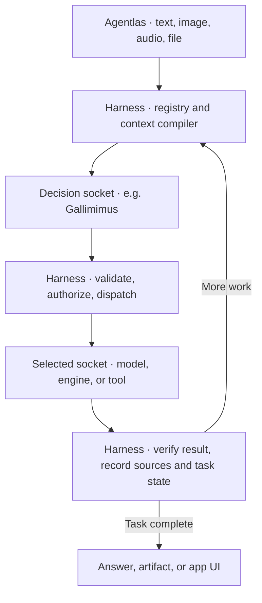

# Model Cocktail

Model Cocktail is an AI motherboard for Agentlas. It connects small, replaceable models and local tools so a phone can carry out multi-step requests. Each socket names a capability. A model, a deterministic engine, or an app adapter can provide that capability.

## The AI motherboard

- **Harness** is the motherboard. Its capability registry connects sockets to providers. Its execution loop manages model loading, passes inputs and results between sockets, and saves checkpoints so work can resume. A failed step can trigger a new decision. The host enforces permissions and approvals.
- **Decision** is the socket for choosing the next capability. Gallimimus is an experimental, replaceable Agentlas model for this socket. It proposes what to run from the request, available capabilities, and current task state. The harness validates and executes the proposal.
- **Specialist sockets** define what each part accepts and returns. The common data bus carries structured inputs, results, and source references. The context compiler selects the relevant history, evidence, and constraints for each model's token budget.



A socket describes a job. Modality describes the data a provider can handle. A multimodal model can serve more than one socket when the host registers and verifies each capability. For example, one model could answer questions about images and extract text through separate Vision and OCR adapters. Media can go through the bus as references that the selected adapter resolves.

Once the required mobile parts are wired, a user could upload a receipt photo and ask “Compare this with last month's spending and show a chart.” Decision proposes OCR, the harness saves the extracted items with the photo reference, and the next decision retrieves the earlier spending data. A calculator compares the amounts. A Presentation adapter can turn the verified values into a chart specification for Flutter to render.

## Run on macOS

Use Python 3.10 or later and a running [Ollama](https://ollama.com/download) server. For local OCR, install Apple's Swift command-line tools. From this checkout, pull the default models and start a task.

```sh
ollama pull qwen3:1.7b
ollama pull qwen3:4b
ollama pull qwen3-vl:2b
ollama pull qwen3-embedding:0.6b

python3 -m cocktail models
python3 -m cocktail run 'Say hello in one sentence.'
```

Pass an attachment with `--file`. The harness returns JSON with the answer, task status, execution events, and artifact paths. SQLite and task files are stored under `~/.model-cocktail` by default. Use `--state` before the command to choose a different directory.

```sh
python3 -m cocktail run 'Describe the image and save the description as Markdown.' --file diagram.png
python3 -m cocktail remember release-owner 'Alex owns the launch handoff.'
python3 -m cocktail run 'Who owns the launch handoff I saved?'
```

The runtime sends requests to loopback Ollama and normally unloads each model after a call. Use `--keep-alive 15s` before the command to retain models briefly.

## Approve and resume actions

The calendar action writes to a local mock calendar. Inspect the proposed title and date before passing the returned approval token to `resume`.

```sh
python3 -m cocktail run 'Create a mock calendar event titled Review for 2027-02-18.'
python3 -m cocktail resume TASK_ID --approve APPROVAL_TOKEN
python3 -m cocktail inspect TASK_ID
```

Use `python3 -m cocktail continue TASK_ID` to restart a running task from its last saved checkpoint.

## Replace a model by capability

| Capability | Default provider |
| --- | --- |
| Decision | Qwen3 1.7B with Qwen3 4B fallback |
| Conversation and reasoning | Qwen3 4B with a Qwen3 1.7B fallback for conversation |
| Vision | Qwen3-VL 2B |
| Embedding and memory | Qwen3 Embedding 0.6B and SQLite |
| OCR | Apple Vision |
| Documents and math | UTF-8 text and Markdown, exact arithmetic |
| Action | Local mock calendar with approval |

Set a slot's providers in priority order in a versioned JSON registry. Save this example as `models.local.json` to use Qwen3 1.7B for conversation.

```json
{
  "version": 1,
  "models": {
    "conversation": ["qwen3:1.7b"]
  }
}
```

```sh
python3 -m cocktail --registry models.local.json run 'Hello'
```

## Mobile profile

The [mobile profile](profiles/mobile.json) starts with a 0.6B decision model, reuses a 1.7B model for conversation and reasoning, and adds independent 2B vision and 0.6B embedding checkpoints. The four Ollama packages occupy about 4.4 GB of disk space. Run this model selection on macOS with Ollama. Native Android and iOS integration is a separate step.

```sh
ollama pull qwen3:0.6b
python3 -m cocktail --registry profiles/mobile.json run 'Say hello in one sentence.'
```

The runtime port keeps task state and capability selection independent of inference. [MobileRuntime](cocktail/mobile_runtime.py) exposes a versioned bridge for a native host to implement. It serializes calls, defaults to a 2,048-token context budget, and asks the host to keep one model resident and release it after inference. The host owns tokenization, model loading, and its platform OCR adapter. [llama.cpp Android integration](https://github.com/ggml-org/llama.cpp/blob/master/docs/android.md) · [llama.cpp Apple framework](https://github.com/ggml-org/llama.cpp/blob/master/docs/xcframework.md)

## License

The harness is released under the [MIT License](LICENSE). Model weights and platform runtimes are governed by their own terms. [Qwen3](https://ollama.com/library/qwen3) · [Qwen3-VL 2B](https://huggingface.co/Qwen/Qwen3-VL-2B-Instruct) · [Qwen3 Embedding 0.6B](https://huggingface.co/Qwen/Qwen3-Embedding-0.6B)
